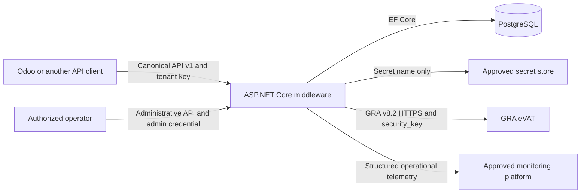
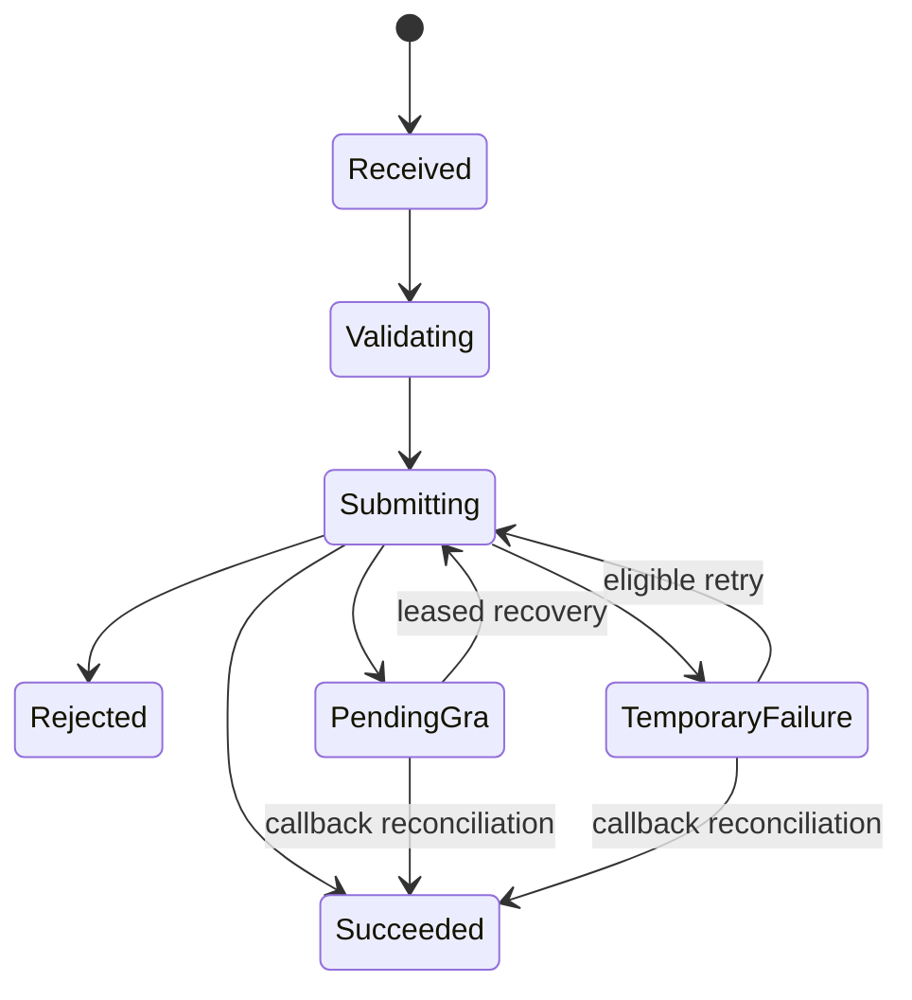

# Architecture

The middleware uses five production projects with inward-facing dependencies:

```text
Api -> Application
Api -> Infrastructure
Api -> GraClient
Infrastructure -> Application -> Domain
GraClient -> Application -> Domain
```

`Domain` has no project dependencies. `Application` defines use cases and outbound interfaces. `Infrastructure` implements persistence, authentication, secrets and auditing. `GraClient` isolates the GRA v8.2 transport contract. `Api` is the HTTP host and composition root.

## System context and boundary



Odoo constructs and consumes the canonical contract. It does not authenticate directly to GRA or contain GRA-specific paths, flags or retry logic. The middleware owns tenant authentication, validation, mapping, external communication, authoritative transaction status, audit and recovery.

## Component responsibilities

| Component | Responsibility | Must not contain |
| --- | --- | --- |
| Api | HTTP routing, authentication boundary, validation, rate limiting and problem responses | GRA transport mapping or database business rules |
| Application | Commands, use-case interfaces and canonical result contracts | EF Core or HTTP implementation details |
| Domain | Tenant, credential, transaction and retry invariants | Framework dependencies |
| Infrastructure | PostgreSQL, authentication, secret lookup, logging, monitoring and workers | Odoo-specific logic |
| GraClient | Exact GRA paths, headers, payload/response mapping and transport safety | Tenant database access or API presentation logic |

## Transaction lifecycle



The middleware is authoritative for this state. Clients query the transaction or repeat the same request with the same idempotency key; they do not invent a replacement submission after a timeout.

## Persistence model

PostgreSQL stores tenants, credential hashes, transaction state, audit events, sanitized exchange records and retry jobs. Foreign keys and tenant-filtered queries preserve ownership. Retry payloads contain confidential fiscal data needed for safe recovery and therefore require encrypted storage/backups and restricted database access in production.

## Deployment and horizontal scaling

The HTTP application is stateless apart from PostgreSQL and the external secret provider. Multiple instances may share the database. Idempotency uniqueness prevents duplicate transactions and database leases prevent multiple retry workers from processing the same job. Rate limiting is currently instance-local; a production proxy or distributed limiter is required when an approved aggregate limit must span instances.

Production topology remains a hosting decision. At minimum it requires TLS termination, a private PostgreSQL path, a managed secret store, central logs/metrics, health-based traffic removal and one controlled migration step per release.

The Odoo-facing tenant credential and the tenant's GRA security key are separate trust boundaries. Tenant identity is resolved from the middleware credential rather than accepted from request data.

## Exchange logging

`ExchangeLoggingMiddleware` records the completed inbound HTTP exchange after correlation and exception handling have produced the final response. It observes authenticated tenant claims where available and accepts a transaction identifier from the invoice controller. Logging uses an independent database scope so a failed business request does not leave its logging operation attached to a failed EF Core change tracker.

`GraEvatClient` records outbound GRA exchanges using transaction, tenant, correlation and idempotency context passed explicitly in `GraInvoiceSubmission`. No global mutable context is used. A logging failure is isolated and never causes a tax request to be sent again or changes its result.

`SensitiveDataSanitizer` is shared by both paths. It redacts sensitive headers and recursively replaces sensitive JSON properties before applying the configured storage limit. Binary and unsupported content types are omitted. The `integration_exchange_logs` table is indexed by tenant/date, transaction, correlation ID, operation/date and outcome/date.

`IExchangeLogRetentionService` deletes records older than `ExchangeLogging:RetentionDays`. A configurable hosted worker schedules cleanup; the service is not exposed through a public endpoint.

## GRA staging boundary

`GraEvatClient` accepts outbound traffic only when the configured environment is `Staging`, the base URL uses HTTPS and the host is explicitly present in `GraApi:AllowedHosts`. Automatic redirect following is disabled. These checks prevent a configuration mistake from sending `security_key` to a production or unrelated host during the staging phase.

The v8.2 staging integration covers all 12 documented operation groups. The callback is the authoritative reconciliation operation only for invoice-shaped submissions. Notes, statements and inventory are left pending after ambiguous delivery because the published contract provides no equivalent callback.

## Retry and reconciliation

`gra_retry_jobs` stores the tenant, transaction, failure classification, canonical payload, attempt counters, next-attempt time and lease state. There is one retry job per transaction.

The retry processor claims one due job using an atomic conditional `UPDATE`. The update succeeds only while the job is due, below its attempt limit and unleased or holding an expired lease. This provides cross-process mutual exclusion without depending on in-memory locks. A worker crash leaves a time-limited lease that another instance can reclaim.

Every retry cycle calls the GRA invoice callback first. If callback finds the invoice, the local transaction becomes successful without resubmission. An ambiguous submission remains reconciliation-only when callback does not find it. A temporary failure can be resubmitted only after callback reports the invoice was not found. Permanent business rejections and authentication failures are not retried.

The background worker is disabled by default. `GraRetry:Enabled` permits scheduling, while `GraRetry:WorkerEnabled` separately permits processing. Retry lifecycle changes create audit events, and GRA submission and callback exchanges use the existing sanitized exchange logger.

## Tenant administration and audit access

Administrative operations use the separately configured `X-Admin-Key`. Credential rotation revokes the old credential and creates the replacement in one database save. Termination is irreversible through the API and revokes all active tenant credentials. GRA configuration updates store only the secret-store name, never the GRA key itself.

Tenant-facing audit lookup derives tenant identity from the authenticated API key and applies that tenant ID in the database query. Audit metadata is not returned by the public query because it can contain operational detail intended for administrators.

## Abuse protection

The global fixed-window limiter partitions requests by a SHA-256 fingerprint of the supplied middleware credential, or by remote address when no credential is present. The raw credential is not stored in the limiter key. Rejected requests return HTTP 429 with `RATE_LIMIT_EXCEEDED` and are still visible to the sanitized inbound exchange logger. Production limits remain configuration-driven.

Request telemetry is captured after correlation ID assignment. Structured completion logs and in-process aggregate counters record status, duration, server failures and rate-limit responses without retaining credentials. The admin-protected operations endpoint combines those counters with PostgreSQL retry and pending-transaction aggregates for alerting.

A hosted retention worker periodically invokes the scoped exchange-log retention service. Cleanup age, startup delay and interval are configuration-driven so every deployed instance applies the same approved policy.

## Decision records

The `docs/adr` directory records the architecture decisions for language/runtime, PostgreSQL, credential protection, GRA secret indirection, reconciliation, conservative retry, sanitized logging and API versioning. These records document decisions; management approval of the C# deviation, production hosting and managed secrets remains an external gate.
